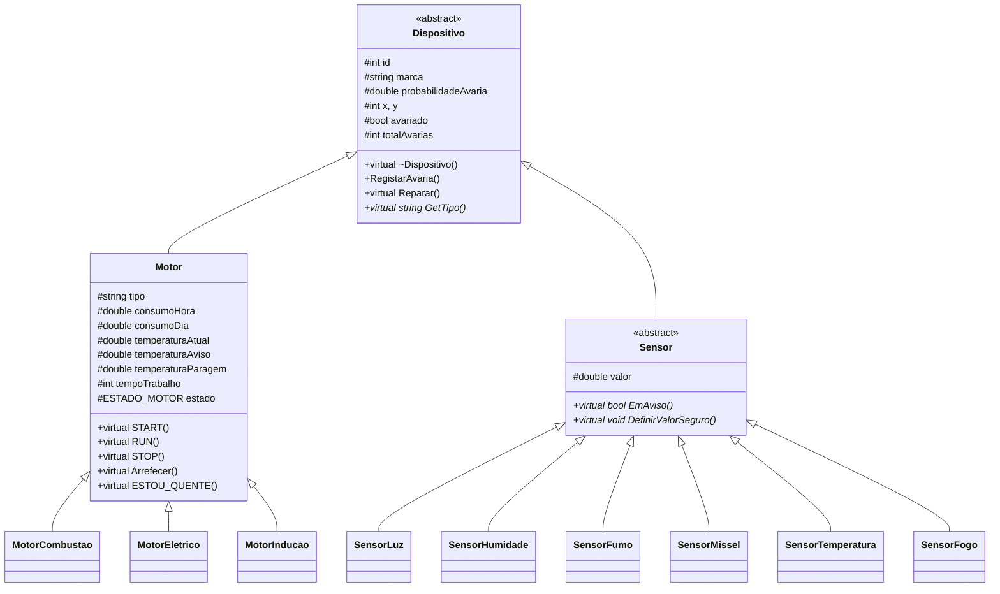

# Documentação Técnica e Especificação da Arquitetura
**Disciplina:** Programação Orientada a Objetos (POO) 2026/2027 — ESTGV  
**Projeto:** Gestão e Simulação de Fábrica Industrial  
**Repositório:** `https://github.com/justachillinguy/projetoPOO`

---

## 1. Instruções de Compilação e Execução

O projeto é multiplataforma e suporta os seguintes ambientes de compilação:

### A) Via Code::Blocks (MinGW GCC)
1. Abrir o ficheiro de projeto `ProjetoPOO.cbp` no Code::Blocks.
2. Selecionar a configuração `Debug` ou `Release`.
3. Pressionar **F9** (*Build and Run*).

### B) Via Linha de Comandos (Makefile / GCC)
```cmd
mingw32-make
bin\Debug\ProjetoPOO.exe
```

### C) Compilação Direta via GCC
```cmd
g++ -Wall -Wextra -std=c++11 -Iinclude src/*.cpp main.cpp -o bin/Debug/ProjetoPOO.exe
```

> **Nota de Execução:** Durante o funcionamento do simulador, o relógio avança de 10 em 10 minutos (ticks). Pressionar a tecla **`M`** a qualquer momento abre o menu interativo de controlo e suspende temporariamente a simulação.

---

## 2. Diagrama de Classes e Hierarquia POO

A arquitetura do sistema segue os princípios fundamentais da Programação Orientada a Objetos: **Encapsulamento**, **Herança**, **Polimorfismo** e **Gestão Dinâmica de Recursos**.



---

## 3. Justificação das Decisões de Arquitetura e Engenharia de Software

### 3.1. Utilização de Apontadores Polimórficos (`list<Motor*>` e `list<Sensor*>`)
* **Decisão:** As coleções centrais da fábrica são mantidas através de listas de apontadores para as classes base (`list<Motor*>` e `list<Sensor*>`).
* **Justificação Técnica:** 
  1. As classes `Dispositivo` e `Sensor` são abstratas por possuírem métodos virtuais puros (`= 0`), sendo impossível a instanciação por valor.
  2. Evita o fenómeno de **Object Slicing** (fatiamento de objetos), garantindo que os atributos e comportamentos específicos das classes derivadas (`MotorCombustao`, `SensorFumo`, etc.) sejam integralmente preservados.
  3. Permite **Polimorfismo Dinâmico** (*late binding*), em que métodos virtuais (`GetTipo()`, `EmAviso()`, `RUN()`) são despachados dinamicamente em tempo de execução.

---

### 3.2. Gestão Explícita de Memória e Destrutores Virtuais
* **Decisão:** Alocação manual via operador `new` com desalocação rigorosa e sistemática.
* **Justificação Técnica:**
  1. Todas as classes base (`Dispositivo`, `Motor`, `Sensor`) definem **destrutores virtuais** (`virtual ~Dispositivo()`, etc.). Isto assegura que, ao eliminar um objeto através de um apontador para a classe base, a cadeia de destruição das classes derivadas seja invocada corretamente.
  2. O destrutor da classe `Fabrica` (`~Fabrica()`) percorre individualmente cada uma das listas (`motores`, `sensores`, `utilizadores`), invocando `delete *it` antes de limpar a estrutura com `.clear()`, prevenindo quaisquer fugas de memória (*memory leaks*).
  3. Os métodos que geram rankings (`Ranking_Dos_Fracos()` e `Ranking_Dos_Mais_Trabalhadores()`) devolvem apontadores de novas listas cuja desalocação é efetuada no ponto de consumo (`main.cpp`).

---

### 3.3. Tipagem Estrita e Conformidade de Padrão
* **Decisão:** Não utilização de dedução automática de tipos (`auto`).
* **Justificação Técnica:** A declaração explícita de todos os tipos e iteradores (por exemplo, `list<Motor*>::iterator itMotor`) garante clareza semântica do código, legibilidade estrita e cumprimento integral das regras estabelecidas para a disciplina.

---

### 3.4. Modelo de Simulação Temporal e Cálculo de Avarias
* **Decisão:** Normalização temporal por passo de simulação.
* **Justificação Técnica:** A probabilidade de avaria definida nos parâmetros do XML representa uma taxa horária. Como cada passo de simulação (`StepSimulacao()`) corresponde a 10 minutos (1/6 de hora), a probabilidade efetiva por passo é modelada matematicamente como `probabilidadePorPasso = (probabilidadeAvaria / 6.0)`. Em cada ciclo, sorteia-se um valor pseudoaleatório no intervalo `[0.0, 1.0]`. Caso seja inferior ao limiar, o dispositivo transita para avaria, suspende operações e incrementa o seu histórico.

---

### 3.5. Ciclo de Manutenção e Gestão Térmica
* **Decisão:** Manutenção autorizada por controlo de permissões e reposição dinâmica de temperaturas.
* **Justificação Técnica:** O método `Fabrica::Manutencao()` valida previamente se o utilizador autenticado possui permissão (`PodeManutencao()`). Durante a intervenção:
  1. Todos os motores são repostos em estado operacional seguro (`STOP`) via `Reparar()`.
  2. A nova temperatura de cada motor é sorteada aleatoriamente dentro do intervalo da zona **VERDE** carregado dinamicamente das definições XML do tipo de motor (`defVerde[tipo]`).
  3. Todos os sensores são restaurados para medições normais (`Reparar()` e `DefinirValorSeguro()`).
  4. A fábrica é reativada (`fabricaAtiva = true`), restabelecendo o ciclo produtivo após eventuais paragens de emergência.

---

### 3.6. Protocolo de Avisos e Invocação
* **Decisão:** Processamento de avisos integrado e simulado via consola sem bloqueio do processo.
* **Justificação Técnica:** O enunciado especifica que métodos como `Aviso_Fumo`, `Aviso_Luz` e `Aviso_Missel` recebam o nome do ficheiro respetivo (`fich_video`, `fvideo`). Tratando-se de um software de consola orientado a ambientes de testes laboratoriais, a invocação do recurso multimédia é simulada através de mensagens estruturadas na consola, preservando a assinatura funcional sem criar subprocessos externos com dependências do sistema operativo.

---

### 3.7. Serialização XML e Relatórios HTML
* **Decisão:** Exportação estruturada dos dados segundo a especificação.
* **Justificação Técnica:**
  - `Fabrica::Relatorio()`: Gera a representação XML da fábrica, exportando metadados de operação, definições de limites térmicos por categoria e o estado detalhado de cada motor (incluindo `<CONSUMO_HORA>`, `<CONSUMO_DIA>` e `<TEMPO_TRABALHO>`) e sensor.
  - `Fabrica::Listagem_HTML()`: Gera uma página HTML padronizada e legível em qualquer navegador com a tabela de equipamentos e parâmetros correntes.

---

## 4. Funcionalidades do Simulador e Menu de Controlo

| Opção | Ação | Descrição |
|---|---|---|
| **1** | `Listar` | Apresenta a listagem completa dos motores e sensores com respetivos estados. |
| **2** | `Ligar` | Altera o estado do motor selecionado por ID para `START`. |
| **3** | `Desligar` | Altera o estado do motor selecionado por ID para `STOP`. |
| **4** | `Get_Estado` | Consulta a informação detalhada de um motor específico. |
| **5** | `Listar_Tipo` | Filtra e lista motores por categoria (`MCOMBUSTAO`, `MELETRICO`, `MINDUCAO`). |
| **6** | `Manutencao` | Executa a intervenção global: reparação, reposição térmica na zona verde e reativação. |
| **7** | `Ranking dos Fracos` | Apresenta a ordenação decrescente das marcas por total acumulado de avarias. |
| **8** | `Ranking dos Mais Trabalhadores` | Apresenta os motores ordenados por tempo total de operação. |
| **9** | `Velocidade` | Ajusta o multiplicador de velocidade temporal do relógio simulado. |
| **10** | `Relatorio XML` | Exporta o ficheiro XML de dados e definições da fábrica. |
| **11** | `Listagem HTML` | Exporta a listagem dos equipamentos para visualização web (`.html`). |
| **13** | `Aviso de Fumo` | Executa o protocolo de alarme de fumo (paragem e registo do vídeo de saídas). |
| **14** | `Aviso de Luz` | Executa o protocolo de luminosidade reduzida (registo do vídeo de regresso). |
| **15** | `Alerta de Missil` | Executa o encerramento de emergência, gravação do estado e registo do vídeo de abrigos. |
| **0** | `Sair` | Encerra o simulador e desaloca a totalidade da memória. |
